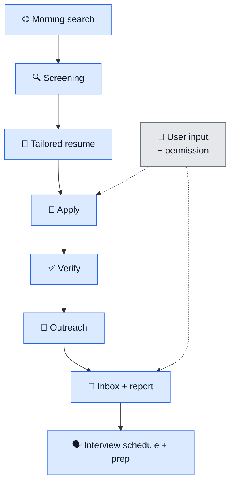

# Job search program

An automated job search that runs on your own Muse, in six blocks. Click a block for its detailed introduction.

<table>
  <tr>
    <td bgcolor="#dbeafe" align="center" width="33%">
      <a href="docs/detailed-documentation.md#job-discovery" target="_blank" rel="noopener"><b>🌐 Job discovery</b></a>
    </td>
    <td bgcolor="#dcfce7" align="center" width="33%">
      <a href="docs/detailed-documentation.md#screening" target="_blank" rel="noopener"><b>🔍 Screening</b></a>
    </td>
    <td bgcolor="#fef9c3" align="center" width="34%">
      <a href="docs/detailed-documentation.md#application" target="_blank" rel="noopener"><b>📝 Application</b></a>
    </td>
  </tr>
  <tr>
    <td bgcolor="#ffedd5" align="center">
      <a href="docs/detailed-documentation.md#application-follow-up" target="_blank" rel="noopener"><b>✉️ Application follow-up</b></a>
    </td>
    <td bgcolor="#e9d5ff" align="center">
      <a href="docs/detailed-documentation.md#linkedin-networking" target="_blank" rel="noopener"><b>🤝 LinkedIn networking</b></a>
    </td>
    <td bgcolor="#fee2e2" align="center">
      <a href="docs/detailed-documentation.md#linkedin-inbox-replies" target="_blank" rel="noopener"><b>💬 LinkedIn inbox replies</b></a>
    </td>
  </tr>
</table>

It was built and tuned over several months of daily use. The daily target is **60 verified applications**.

## Installing it 🛠️

Hand this repo to your Muse and say "install it and onboard me now.” Your muse will install this whole skill and then kick-off the onboarding process.

Installing takes [~20 minutes] and onboarding takes [~8 minutes] on its own, and you can always come back and pick up where you left off at any point during this process.

## What it does

Here is one day, top to bottom:

Design principle: **code decides and tracks, Muse does the legwork.** The code is the air traffic control tower, and each Muse agent is an individual aircraft: the tower assigns every mission and keeps the record, and each plane flies only the mission it was given.

- 🌐 Searches <a href="https://jobright.ai" target="_blank" rel="noopener">Jobright</a> and Indeed each morning for **postings from the last 24 hours**, and takes in your LinkedIn job alert emails.
- 🔍 Screens every posting before opening it: your **block list**, companies you **already applied to**, and a **company gate** (more on that below).
- 📝 Builds a **tailored resume** for each posting from your base resume, then applies on the employer's own site.
- ✅ Verifies each submission: the **confirmation email** in your Gmail, or the success message the site shows.
- 🤝 Finds hiring contacts for the roles you applied to and sends up to **30 LinkedIn invitations a day**, each with a short note written for that role.
- 💬 **Replies to your LinkedIn inbox for you.** A watch checks for new recruiter messages every 15 minutes and answers under your standing reply rules. Interview requests and assessments become to-dos. Rejections are logged and left alone.
- 🌅 Sends you a **short report every morning**: what went out, what moved, what needs you.

## Running costs

Three subscriptions cover the whole thing:

- **Muse.** This system runs on Muse, Meta's personal AI agent. How much plan you need depends on how hard you run it. A light version can fit on the **free tier**. Running the full daily workflow fits within the **$20/month tier**. You should not need anything above that.
- **LinkedIn Premium Career.** The outreach side runs on it. LinkedIn also caps invitations at **roughly 100 a week**, Premium or not. When the cap is hit, sending pauses until the week resets.
- **A paid <a href="https://jobright.ai" target="_blank" rel="noopener">Jobright</a> plan.** Jobright is one of the two main sources of fresh postings, and the **free tier does not cover this volume**.

🔵 Don't want LinkedIn Premium?

That is fine. You lose one part: **the invitation outreach**. Without Premium Career, the system does not send the daily invitations to recruiters and hiring managers for the jobs you applied to.

**Everything else still works.** You can still search, screen, tailor resumes, and apply for jobs all the way through, with verification, inbox replies, and interview scheduling included. Premium only powers the outreach on top.

What you would save: Premium Career starts at **$39.99 a month**, or **$239.88 a year** on annual billing. Prices change, so check the current figure on <a href="https://premium.linkedin.com/careers/career#accordion-619758614d-item-db243398ff" target="_blank" rel="noopener">LinkedIn's Premium Career page</a>.

🟢 Don't want to pay for Jobright?

That is fine too. You lose one of the three discovery sources: **the Jobright searches**. No Jobright results come in during the morning search.

Jobs still arrive through **Indeed** and your **LinkedIn job alert emails**, just fewer of them each day, so reaching the daily target of **60 verified applications** gets harder. Everything after discovery works the same on whatever is found: screening, tailored resumes, applying, outreach, inbox replies, and interview scheduling.

What you would save: Jobright's paid plan, Turbo, is billed **weekly at $17.99**, monthly at $39.99, or quarterly at $89.99. Jobright has no public pricing page; the prices appear in the app when you sign up, so check the figure it shows you before you commit.

Indeed, LinkedIn job alerts, and Revelio are free. So are Gmail, Google Calendar, and Google Tasks. There are no per-application fees.

## Your part

A few minutes a day, in two forms:

- 👆 **Tap and captcha sessions, twice a day.** **Un-bypassable.** Solve simple one-click tasks at a fixed daily schedule. Guides: <a href="docs/tap-sessions/" target="_blank" rel="noopener">tap sessions</a> and <a href="docs/captcha-sessions/" target="_blank" rel="noopener">captcha sessions</a>.
- 📦 **A few fully manual applications.** **Un-bypassable.** Apply on the job site yourself, with <a href="https://jobright.ai" target="_blank" rel="noopener">Jobright</a>'s free autofill plugin. Tailored resume and a pre-filled application form are provided. Guide: <a href="docs/manual-packets/" target="_blank" rel="noopener">manual packets</a>.

## Access it needs

- Your LinkedIn account, signed in, Premium Career active.
- **LinkedIn notification emails turned on.** There is a <a href="docs/linkedin-notifications.md" target="_blank" rel="noopener">step-by-step setup guide</a>.
- Your Gmail connected for confirmations, recruiter replies, and LinkedIn notifications.
- Your base resume and your standing answers (<a href="#standing-answers-checklist">checklist</a>).

📋 <b>What you need to hand over before it can run</b>

- A current resume (PDF).
- The standing facts forms ask for: legal name, email, phone, home address, work authorization, education history, notice period.
- Your targets: job titles, locations or remote, and the lowest pay you will accept for onsite and for remote roles.
- A block list: companies you will never apply to.
- Reply rules: what to accept, what to decline, and when a conversation should come back to you.
- Accounts: LinkedIn with Premium Career, Jobright on a paid plan, Indeed, and a Gmail account connected for mail, calendar, and tasks.
- Two times a day when you can tap approvals and solve captchas.

The longer version, with why each item is needed, is in <a href="docs/getting-started.md" target="_blank" rel="noopener">docs/getting-started.md</a>.

## What it will not do

- 🚫 It will not **invent experience, skills, employers, or numbers**. Everything on an application comes from your resume and your standing answers. The one exception is fun-fact style questions, where the user of this system chose to let it make up something harmless.
- 🚫 It will not apply to a **blocked company**, a company you **already applied to**, or a job that fails your **pay or role rules**.
- 🚫 It will not **work around LinkedIn's limits, a site's bot checks, or a login wall**. A blocked route becomes a manual packet for you instead.
- 🚫 It will not **send an email without your approval tap**. LinkedIn replies follow the standing rules you set, and **anything outside those rules comes back to you first**.
- It **cannot promise results**. Recruiters decide who gets interviews. The system does the searching, applying, and bookkeeping at a volume one person cannot match by hand.

## Make it yours 🎛️

Almost everything about this system is a setting, and the settings in this repo are one person's. Change them before you run it.

> One example: the **company gate**. This setup checks each company on Revelio before applying, and skips companies under 100 people or with more than half their staff in South Asia. That rule is personal. It comes from this user's own job search history, and it will not fit everyone. Your Muse can set the gate to your own numbers, use a different source, or turn it off.

The same goes for the pay floors, the job titles searched, the block list, the daily targets, the reply rules, and the session times. The full list of customizable fields, where each one lives, and how to customize them, is in <a href="docs/customization.md" target="_blank" rel="noopener">docs/customization.md</a>.
## It gets better the more you use it 🌱

- **This system is tuned by use.** Nearly every rule in it started as someone noticing something mid-run and telling their Muse to change it.
- **When yours does something you don't like, say so.** Your Muse updates the rule everywhere it is written, reads the change back to you, and from then on it runs your way.
- **The more you tune it, the better it fits.** Your titles, your pay floors, your companies, your reply style. Two people running this end up with two different systems, and that is the point. The longer you run it, the more it hunts the way you would.

## How it's organized 🗂️

- **Top level:** the scripts you run by name. `spine.py` is the control point, `supervisor.py` watches the workers, `onboarding.py` is the setup, `install.py` installs.
- **`engine/`:** the shared library code (screening, the company gate, stocking, inbox, invitations).
- **`checks/`:** the standalone scan scripts the scheduled jobs run (shadow pass, email scan, stall and bench checks).
- **`tools/`:** one-off utilities.
- **`config/`:** your answers and your rules. **`workflow/`:** the scheduled job definitions. **`career-ops/`:** the contact-finding skill. **`docs/`:** the guides. **`tests/`:** the test suites.

## More documentation

- <a href="docs/onboarding.md" target="_blank" rel="noopener">docs/onboarding.md</a>: **start here.** The interactive setup. Your Muse walks you through it step by step.
- <a href="docs/linkedin-notifications.md" target="_blank" rel="noopener">docs/linkedin-notifications.md</a>: the one-time LinkedIn setup. Turn on the job alert, message, and invitation emails the system reads.
- <a href="docs/tap-sessions/" target="_blank" rel="noopener">docs/tap-sessions/README.md</a>: the approvals only you can give, why they cannot be automated, and how the sessions run.
- <a href="docs/captcha-sessions/" target="_blank" rel="noopener">docs/captcha-sessions/README.md</a>: why Muse never touches a captcha, and how captcha sessions work.
- <a href="docs/manual-packets/" target="_blank" rel="noopener">docs/manual-packets/README.md</a>: the applications you submit yourself, why those sites cannot be reached any other way, and how to submit one.
- <a href="docs/getting-started.md" target="_blank" rel="noopener">docs/getting-started.md</a>: what a new user provides, item by item.
- <a href="docs/customization.md" target="_blank" rel="noopener">docs/customization.md</a>: every customizable field and where it lives.
- <a href="docs/detailed-documentation.md" target="_blank" rel="noopener">docs/detailed-documentation.md</a>: the full technical documentation, including the mail flows and the running order of a day.
- <a href="docs/application-program-design-2026-11-04.md" target="_blank" rel="noopener">docs/application-program-design-2026-11-04.md</a>: the original program design.
- <a href="workflow/" target="_blank" rel="noopener">workflow/</a>: the goal file with the standing rules, and the scheduled jobs that run the workflow.
- <a href="career-ops/" target="_blank" rel="noopener">career-ops/</a>: the contacto method used to find hiring contacts.
